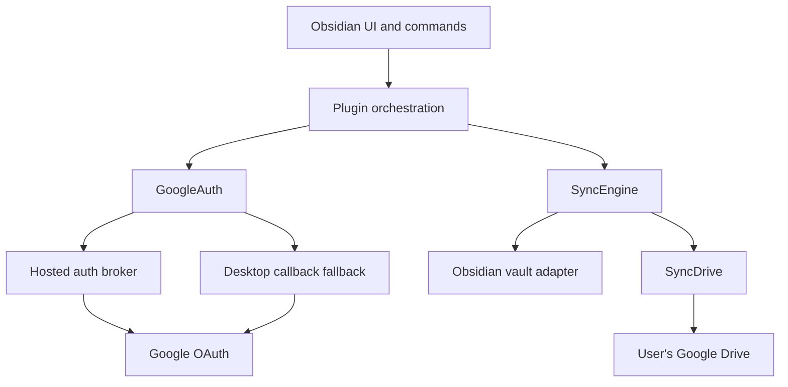

# Architecture

## Host and modules

Threads extends Obsidian; it does not implement a new editor or knowledge graph.
`src/main.ts` exports the plugin. `src/plugin.ts` wires commands, lifecycle,
serialization, account checks, and scheduling. UI code calls that layer, not
the Drive transport directly. `SyncEngine` works through local/cloud interfaces;
`ObsidianSyncLocal` implements the Vault API and `SyncDrive` owns revision I/O.

The broker handles authentication, not note transfers. It still handles tokens
capable of accessing authorized Drive files, so users must trust its operator.
`GoogleHttp` restricts direct requests to intended Google endpoints and sanitizes
errors. Hosted auth uses a separate validated HTTPS origin.

## Portable runtime

Shared code uses Web Crypto randomness, TextEncoder, and bundled SHA-256 from
`@noble/hashes`. It does not need `Buffer` or module-scope Node runtime imports.
`src/platform/desktop-login.ts` loads Node HTTP/crypto only for the desktop
fallback. Electron browser launch is guarded by `Platform.isDesktopApp`;
mobile opens the system browser through `window.open`.

Obsidian `requestUrl` supplies HTTP without browser fetch/CORS assumptions.
The mobile smoke test runs the compiled artifact in a VM without `Buffer` and
rejects every `require` except `obsidian`. It is not a physical iOS/Android test.

## Hosted authorization

1. The device creates independent PKCE and session-claim secrets. It sends only
   SHA-256 challenges to `POST /v1/sessions`.
2. The broker generates an opaque session ID, OAuth state, and ten-minute expiry.
   The plugin checks the returned Google URL, client, callback, scope, and PKCE
   challenge before opening it.
3. Google redirects the browser to the broker's registered HTTPS callback.
   The broker verifies state and records the code once. Its return-page deep
   link carries no code or token.
4. The device polls `/v1/sessions/:id/claim`, proving possession of both original
   secrets. The broker verifies both and exchanges the code with Google using
   PKCE and the server-only Web client secret.
5. Concurrent claims share one exchange; results stay in memory until expiry
   to tolerate a lost response. The device stores its refresh grant in Obsidian
   SecretStorage, keeping access tokens in memory.
6. `/v1/refresh` exchanges that grant when needed. Reset/unload rejects late
   authorization results. No note payload is sent to either broker endpoint.

No persistent account database is stored. In-progress device login is not
persisted: app/broker restart requires a new login. Completed grants survive
ordinary plugin restarts. Disconnect clears local grants, not Google's permission.

## Storage protocol

Automatic sync selects a distinct cloud vault ID. Names alone do not identify
the same vault. The selection binds the Google permission ID and OAuth client
ID to prevent reuse under another account/app.

Each revision is readable Markdown under the original subfolders, named with a
generated Drive ID. Metadata records path, hash, parent revisions, and ownership.
This is a validated revision graph, not a mutable current-file mirror.

The engine compares local content and remote heads with a persisted baseline.
One-sided changes transfer; concurrent changes create conflict copies. Explicit
resolution publishes the chosen local content with observed heads as parents.
There is no automatic text merge.

Pending uploads and preallocated IDs are saved before the network request.
Retries reuse the ID; HTTP 409 is accepted only after matching metadata and
bytes. Downloads use Vault.process with an expected-content check so typing
during download is not silently overwritten. Missing parents, graph cycles,
ambiguous folders, and equivalent-path collisions stop reconciliation.

History is fully listed, not read from an incremental Drive cursor. Bounds are
1 MiB per note, 1000 paths, and 5000 revisions. Change cursors, history retention,
rename identity, deletion tombstones, and attachments remain future work. The
manual-copy and sample-test features use separate folders/protocols; old manual
copies are not automatically imported as revisions.

## Persistence and lifecycle

| Location | Data |
| --- | --- |
| Local Markdown | Normal notes and conflict copies |
| Plugin `data.json` | Settings, secret reference, baselines, pending note content |
| Checkpoint backups | Previous account-bound sync state when switching vault |
| Obsidian SecretStorage | App configuration and device refresh grant |
| Broker memory | Short-lived state, codes, cached login results |
| Google Drive | App-created folders and readable revisions |

Plugin data and checkpoint backups can contain private notes: never commit
them. SecretStorage is not guaranteed OS-keychain protection or isolation from
other plugins. Drive content is not end-to-end encrypted.

Sync is opt-in. Edits debounce for 1.2 seconds; successful runs schedule a poll
after 10 seconds. Failures back off to five minutes. Hiding the app clears the
next timer but does not promise to cancel an in-flight request. Foregrounding
schedules reconciliation. Mobile suspension/closure prevents guaranteed
background sync. Unload cancels auth and prevents further local work. These
intervals are scheduling choices, not latency guarantees.
